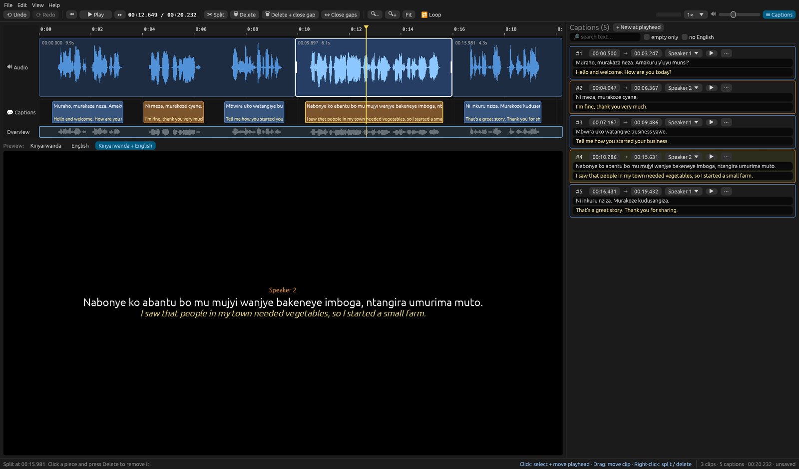

# Audio Editor

A desktop audio and caption editor written in Rust with [egui](https://github.com/emilk/egui). Cut a
recording the way you would in CapCut, fix its subtitles, add an English translation, and export the
edited audio, SRT files, or a black-screen video with the captions burned in.

It was built for Kinyarwanda interviews, and it ships with an optional Python pipeline that produces the
first draft of the captions: speaker diarization with NVIDIA Nemotron 3 Diarization and transcription with
NVIDIA's Kinyarwanda speech models.



## Features

- **Clip-based audio editing.** Split at the playhead, delete a piece (leaving a gap or closing it),
  drag clips to rearrange them with snapping, and trim clip edges. Undo and redo cover every edit.
- **Captions that follow the audio.** Captions are tied to the audio under them, so they move, split and
  disappear with it. Drag a caption or its edges to retime it, and edit its text in the sidebar.
- **Translation.** Every caption has a Kinyarwanda line and an English line. An optional AI button
  re-translates a caption through [OpenRouter](https://openrouter.ai).
- **Navigation.** Waveform with zoom and scroll, an overview strip, playback speed from 0.5× to 2×,
  volume, looping, and a live preview of the captions as they will appear in the video.
- **Review tools.** Search, find & replace across both languages, filters for captions with no text or
  no English, and speaker renaming.
- **Export.** Edited audio (m4a, mp3, wav, flac, ogg), SRT in Kinyarwanda, English or both, and an MP4
  with a black background and burned-in captions coloured by speaker. The video holds one frame per
  caption change instead of 25 identical frames a second, so a 15-minute export takes about 30 seconds.
- **Projects.** A project is a small JSON file next to your audio. Edits autosave every 20 seconds.

## Setup

### Requirements

- Linux. macOS may work but is untested; Windows is not supported yet.
- Rust, a recent stable toolchain (tested with 1.97). Install it with [rustup](https://rustup.rs).
- `ffmpeg` on your `PATH`, built with `libass` (needed for the video export).
- Native libraries for audio, windowing and file dialogs. On Debian or Ubuntu:

  ```sh
  sudo apt install ffmpeg libasound2-dev libgtk-3-dev libxkbcommon-dev pkg-config
  ```

### Build and run

```sh
git clone https://github.com/Aurumdev952/audio-editor.git
cd audio-editor
cargo build --release
./target/release/audio-editor demo/demo_project.json
```

The demo is a 20-second synthetic two-speaker clip with Kinyarwanda and English captions.

Other ways to start:

```sh
./target/release/audio-editor path/to/recording.m4a                 # audio only
./target/release/audio-editor path/to/recording.m4a captions.srt    # audio + captions
./target/release/audio-editor path/to/project.json                  # a saved project
```

Run the tests with `cargo test`. The export test needs `ffmpeg`.

### AI translation (optional)

The 🌐 *Translate with AI* actions call OpenRouter. Set your key before starting the editor:

```sh
export OPENROUTER_API_KEY=sk-or-...
```

The default model is `google/gemini-3.5-flash-lite`. You can change it under **Edit ▸ Translate with AI**.
Claude models are refused on this path on purpose.

## Using the editor

| To do this | Do this |
|---|---|
| Move the playhead | Click the ruler or the audio. Use ← / → for 1 s (Shift for 5 s) and `,` / `.` for 0.05 s |
| Cut the audio | Right-click the audio → **Split here**, or press **S** / **Ctrl+B** |
| Remove a piece | Click it (white outline), then press **Delete**. **Shift+Delete** also closes the gap |
| Fill a gap | Drag the next clip into it (it snaps to clip edges), or right-click the gap → **Close this gap** |
| Trim a clip | Drag the white handles on a selected clip's edges |
| Fix a caption | Double-click it, then type in the sidebar. Drag it or its edges to retime it |
| Add a caption | Double-click empty caption track, or press **N** at the playhead |
| Split / merge captions | **C** splits at the playhead, **M** merges with the next one |
| Zoom | Ctrl+mouse wheel, or **+** / **−** |
| Save | **Ctrl+S** |

The bottom-right of the status bar always says what a click or drag will do over whatever is under the
mouse. **Help ▸ Keyboard shortcuts** lists every key.

## Transcription pipeline (optional)

`pipeline/` turns a Kinyarwanda recording into a speaker-labelled SRT that the editor can open.

1. `diarize.py` finds who speaks when, with [NVIDIA Nemotron 3 Diarization](https://huggingface.co/nvidia/Nemotron-3-Diarization) (up to 8 speakers).
2. `chunk.py` cuts the audio into speaker turns of at most about 10 seconds, splitting long turns at the quietest moment.
3. `transcribe_nemo.py` transcribes every chunk with `stt_rw_conformer_ctc_large` and `stt_rw_conformer_transducer_large`.
4. `build_srt.py` writes the SRT and a JSON transcript.

It needs Python 3.12+, an NVIDIA GPU (Ampere or newer) and NeMo from its main branch:

```sh
python -m venv .venv
.venv/bin/pip install -r pipeline/requirements.txt
PYTHON=.venv/bin/python pipeline/run.sh recording.m4a out/
./target/release/audio-editor recording.m4a out/captions.srt
```

`asr_hypotheses.json` keeps both models' output for every chunk. The two often disagree, and merging them
(by hand or with an LLM) gives a better draft than either alone; `build_srt.py` uses a `final` field when
present. Speech recognition for Kinyarwanda is far from perfect, so expect to correct the draft in the
editor.

## Project layout

```
src/
  main.rs       window setup
  app.rs        UI: toolbar, timeline, caption sidebar, dialogs
  model.rs      clips, captions, SRT reading and writing
  audio.rs      decoding through ffmpeg, waveform peaks, playback
  export.rs     audio, SRT and video export
  translate.rs  OpenRouter translation
pipeline/       diarization and transcription scripts
demo/           sample audio, captions and project
```
